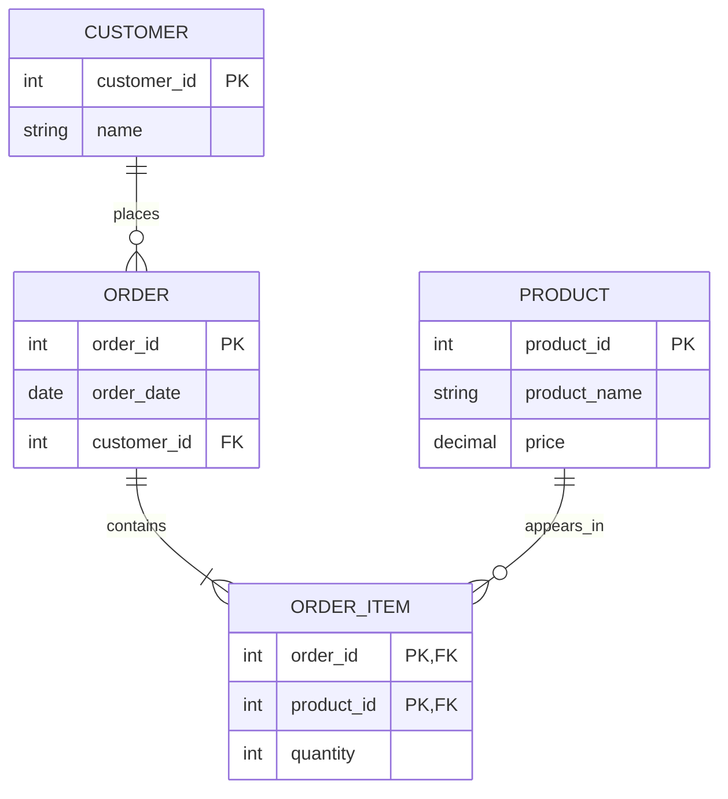
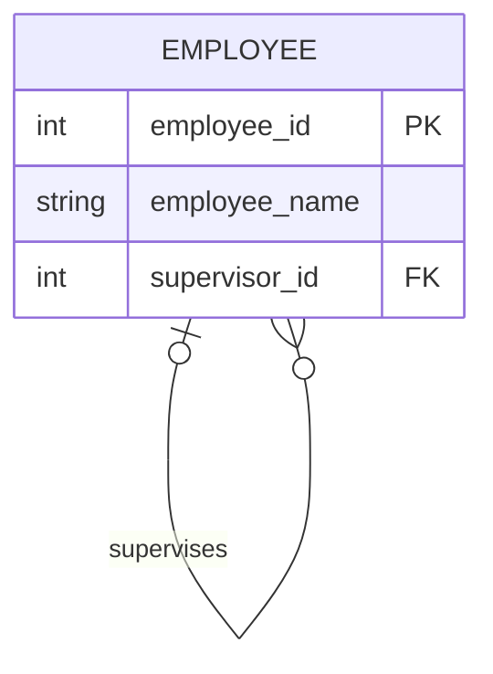
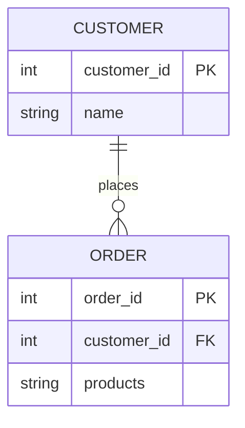

# Task 5: Mermaid ER Diagram Lab

### Diagram 1: Good Design — Online Store

This diagram represents a simple online store. Customers place orders, and orders contain products. The associative entity `ORDER_ITEM` resolves the many-to-many relationship between orders and products.

**Critique:** This is a good design because it uses clear entities, primary keys, foreign keys, and an associative entity. It avoids storing multiple product IDs in one order column.

### Diagram 2: Strange Design — Recursive Employee Relationship

This diagram models employees who supervise other employees. The relationship connects the `EMPLOYEE` entity to itself.

**Critique:** This design is unusual because an entity relates to itself. It is useful for organizational hierarchies, but queries must handle multiple levels of supervision. The optional side allows an employee to have no supervisor, such as a company director.

### Diagram 3: Wrong or Confusing Design — Products Stored as Text

This diagram represents a poorly designed order system where several products are stored in one text field.

**Critique:** This design is confusing because the `products` field may contain several product names separated by commas. Individual products cannot be reliably referenced, searched, or constrained using ordinary foreign keys. A separate `PRODUCT` table and `ORDER_ITEM` junction table would be better.